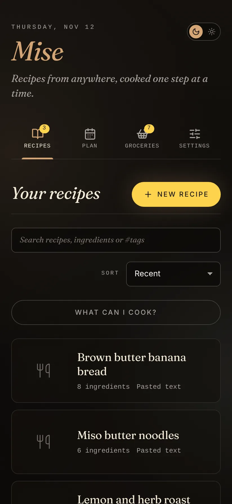
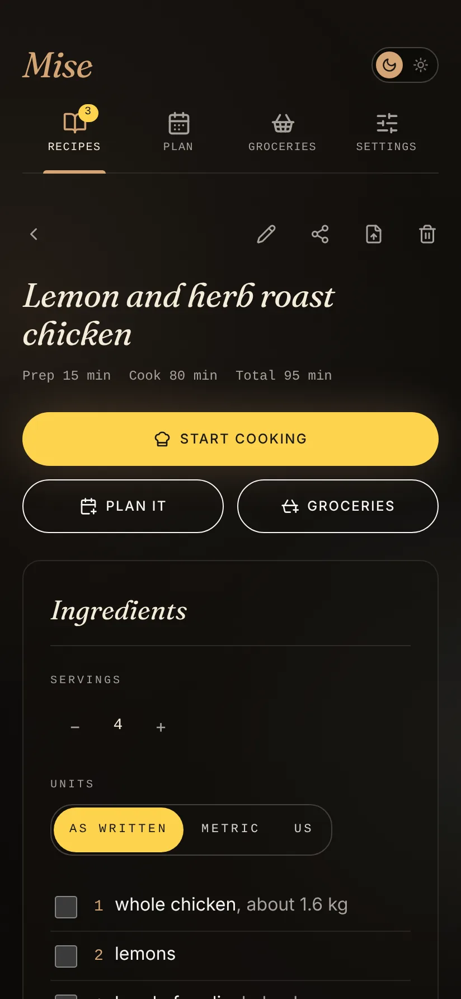
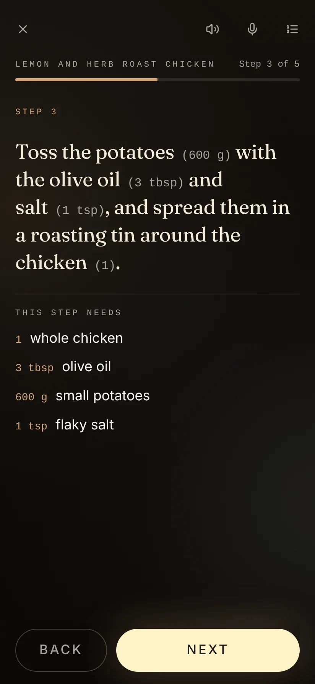
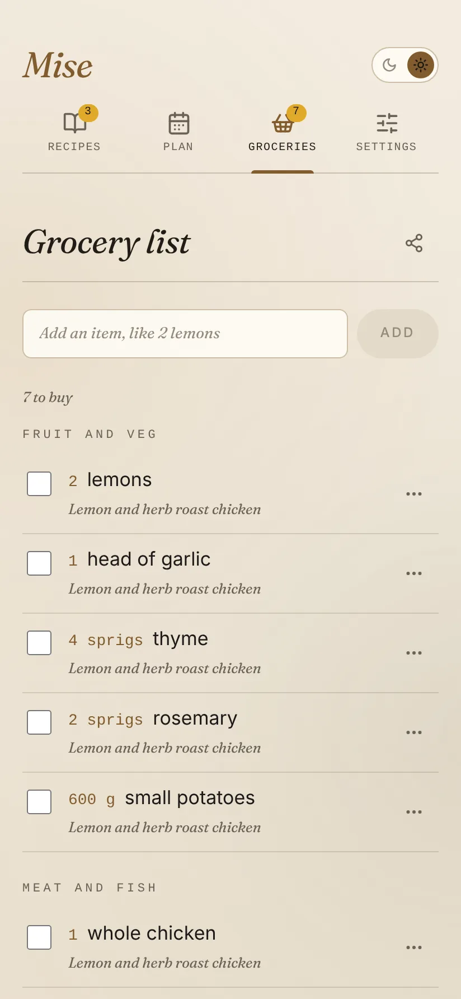

<p align="center"></p>

<h1 align="center">Mise</h1>

<p align="center"><em>Recipes from anywhere, cooked one step at a time.</em></p>

<p align="center">
  Android&nbsp;·&nbsp;<a href="https://github.com/not-mehul/Mise/releases/latest">Latest release</a>&nbsp;·&nbsp;MIT&nbsp;·&nbsp;Created by <strong>Mehul Sen</strong>
</p>

---

Mise is a cooking companion for Android. Share a recipe to it from Instagram, TikTok, YouTube, a website, a photo of a cookbook page or plain text; check what it read and save it to your collection; cook it one step at a time; and turn it into a grocery list. Recipes stay on the phone, with no accounts and no server.

<p align="center">
  
  
  
  
</p>

## Features

### Save a recipe from anywhere

- **Links.** Most recipe sites publish a structured recipe, and Mise reads it field for field, picture included. Pages without one fall back to their main text.
- **Social posts.** Instagram captions, TikTok captions, YouTube and Shorts descriptions, and Facebook, Threads and Pinterest link previews. Lines like "520 kcal | 45g P | 50g C | 12g F" become the recipe's macros.
- **Photos** of a cookbook page, read offline by on-device text recognition. Several photos become one recipe, and two-column pages are read column by column.
- **Pasted text or by hand.** Mise finds the title, servings, times, ingredients and method in English, Spanish, French or German, by their headings or the shape of each line.
- **Recipe files**: a Mise backup, a Paprika export or schema.org recipe JSON from Mealie and other apps.
- **Nothing is saved unseen.** Every import ends on a review screen, and lines Mise couldn't place wait under *Unsorted* for you to sort.

### Your collection

- **Ingredients that understand themselves.** Each line is split into amount, unit, item and note, so recipes **scale** to any number of servings and switch between **metric and US units**, including cups of flour to grams and oven temperatures.
- **Search, collections and sorts**, plus *What can I cook?* from what you have.
- **Several photos per recipe**, sections in the method, nutrition per serving, and a cook log with ratings and notes.
- **A week's meal plan.** Put recipes on days for the next four weeks and send everything planned to the grocery list in one go.

### Cooking mode

- **One step per screen** in large type, after a *mise en place* page that lists everything to gather. Each step shows the ingredients it names, with their amounts in the text.
- **Move hands-free.** Buttons, a swipe, a tap on the edge, the arrow keys or the volume keys, or say "next", "back", "repeat", "timer", "ingredients" or "stop" in any of the four languages.
- **Timers from the steps.** A duration in a step is a *Start* button. Timers run side by side and ring like an alarm, even with the phone locked or Mise closed.
- **Read aloud** each step, keep the screen on, and pick up at the same step within four hours.
- **A wide layout** on tablets, with the whole ingredient list beside the step.

### Groceries

- **One running list, grouped by aisle** in shop order. The same item from two recipes becomes one line, with quantities added up.
- **Pantry staples** like salt, pepper and oil are left unticked. Move an item and Mise remembers its aisle.
- **Share** what is left as plain text, add notes for the shop, and see the list on a **home-screen widget**.

### Your data

- **Backups** as one zip with recipes, photos, collections, groceries, the plan and settings. Importing merges, and deletions stay deleted.
- **Sync through a folder** you choose, kept the same across phones with Syncthing, Drive or Nextcloud.
- **Send a recipe as a file**, photos included, for another Mise to open.
- **Home-screen shortcuts** straight to the list or a new recipe.
- **Links from the other apps.** `mise://open?id=<recipe>` opens a recipe and `mise://import?url=<page>` opens the import review for a page.
- **A dish for your nookling.** With [Nookling](https://github.com/not-mehul/Nookling) installed, the end of cooking mode offers to share the dish: Nookling opens and asks whether to add it to the pet's Pantry. Only the recipe's name is sent.
- **Four languages**, English, Spanish, French and German, and **Dusk and Dawn themes**.
- **A little delight.** Confetti when you finish cooking a recipe and when you tick off the last grocery, an idle bowl of soup to stir, and four easter eggs, counted in Settings. All of it respects reduced motion.

## Private by design

Recipes stay on the phone. Photos are read by the phone's own text recognition, and the network is used only to fetch a page you share. There is no Mise server and no account.

## Install

Download the signed APK from the [latest release](https://github.com/not-mehul/Mise/releases/latest) and open it on your phone. The same app also runs in a browser for trying it out, without photo reading.

## The Dusk & Dawn apps

Mise is one of seven apps by Mehul Sen that share one design system, [Editorial Dusk & Dawn](https://github.com/not-mehul/dusk-dawn), and a common link scheme, so they can hand things to each other.

| App | What it is for |
|---|---|
| [Waymark](https://github.com/not-mehul/Waymark) | Your whole trip, offline: flights, stays, plans and costs on one timeline |
| [BookShelf](https://github.com/not-mehul/BookShelf) | Books, films, shows and the lines worth keeping |
| [Ledger](https://github.com/not-mehul/Ledger) | A record of cities, scored on what matters to you |
| [Colophon](https://github.com/not-mehul/Colophon) | Inspect, fix and rebind EPUB editions |
| [Rosetta](https://github.com/not-mehul/Rosetta) | A quiet library and reader for books, papers and notes |
| [Mise](https://github.com/not-mehul/Mise) | Recipes from anywhere, cooked one step at a time |
| [Nookling](https://github.com/not-mehul/Nookling) | A small round friend who is happy whenever you drop by |

## Build from source

Svelte 5 and TypeScript, built by Vite, with Dexie for storage, in a Capacitor 8 Android app. You need Node 22.12 or later, plus JDK 21 and Android Studio for the app.

```sh
npm install
npm run dev          # http://localhost:5173
npm run check        # contrast, lint, literal colours, typecheck, unit tests
npm run android      # build, sync and open Android Studio
```

[docs/DEVELOPMENT.md](docs/DEVELOPMENT.md) covers the scripts, tests, project layout, how recipes are read and the link scheme. [RELEASING.md](RELEASING.md) covers signing and releases.

## Credits

Mise is designed and built by **Mehul Sen** ([@not-mehul](https://github.com/not-mehul)).

- Text recognition: Google ML Kit, bundled in the app.
- Libraries: Dexie (Apache 2.0), fflate (MIT), Capacitor (MIT) and [Lucide](https://lucide.dev) icons (ISC).
- Fonts and design: Fraunces (SIL Open Font License) through [dusk-dawn](https://github.com/not-mehul/dusk-dawn).

## Licence

[MIT](LICENSE) © 2026 Mehul Sen.
